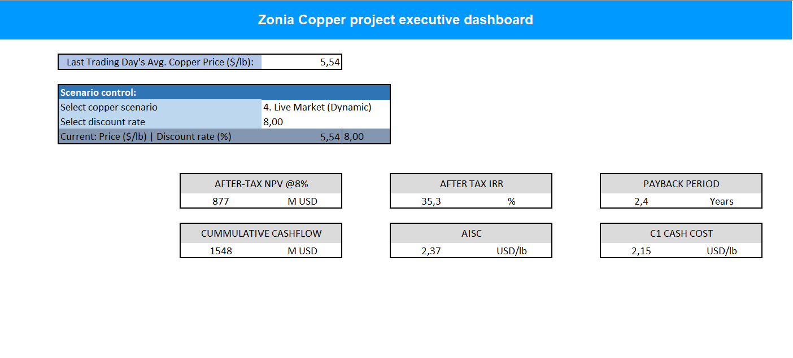

# Edge Copper - Zonia Copper Project (NI 43-101 PEA) DCF Valuation Model

Independent Life-of-Mine (LOM) Discounted Cash Flow valuation model for Edge Copper Corp.’s **Zonia Copper Project** (Arizona, USA), built from first principles using the March 2026 NI 43-101 Preliminary Economic Assessment (PEA).

---

### Executive Dashboard Preview

---

### Key Valuation Outputs (@ 8% Discount Rate)

| Metric | Downside (`$3.68/lb`) | PEA Base Case (`$4.64/lb`) | Live Market (`$5.54/lb`) | PEA Spot Case (`$5.98/lb`) |
| :--- | :---: | :---: | :---: | :---: |
| **After-Tax NPV @ 8%** | `$55.9M` | `$487.9M` | `$876.9M` | `$1,061.0M` |
| **After-Tax IRR** | `9.2%` | `23.5%` | `35.3%` | `40.7%` |
| **Payback Period** | `7.6 yrs` | `4.0 yrs` | `2.4 yrs` | `2.2 yrs` |
| **Cumulative Post-Tax FCF** | `$359.6M` | `$984.4M` | `$1,547.5M` | `$1,813.1M` |
| **C1 Cash Cost / AISC** | `$2.15/lb` / `$2.37/lb` | `$2.15/lb` / `$2.37/lb` | `$2.15/lb` / `$2.37/lb` | `$2.15/lb` / `$2.37/lb` |

---

### Workbook Guide (5 Tabs)
* **`Control`**: Interactive copper price scenario selector, dynamic discount rate input, and executive KPI summary.
* **`Assumptions`**: Macro price deck, mine plan parameters (`218.4 Mt` leach feed at `0.245% TCu`, `73.8%` oxide recovery, `783.7 Mlbs` payable cathode), unit OpEx (`$7.63/t`), and CapEx inputs.
* **`Production`**: Annual mining and heap-leach schedule (`Y-1` construction through `Y11` residual leaching) and PEA cash flow reconciliation.
* **`DCF`**: Unlevered/project cash flow waterfall, straight-line tax depreciation, and U.S. / Arizona mining tax cascade (**2.5% AZ Severance Tax** on 50% net base, **4.78% AZ Corporate Tax**, and **21% U.S. Federal Tax** with **15% IRC § 613 percentage depletion** capped at 50% of taxable income).
* **`Market`**: Historical COMEX copper futures pricing feed.

---

### Disclaimer
*Constructed independently for analytical and educational purposes based on publicly disclosed NI 43-101 technical report data (Edge Copper Corp., March 2026). Not investment advice.*
